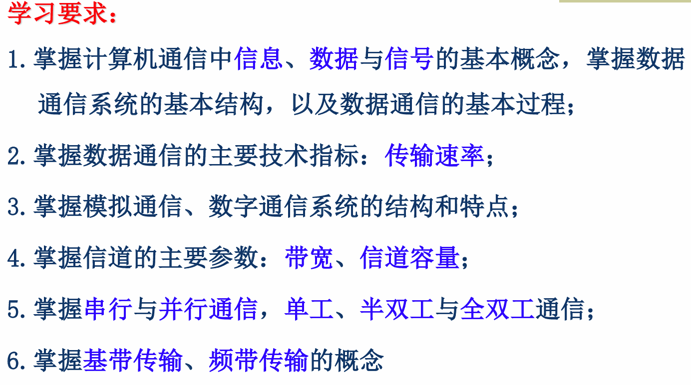
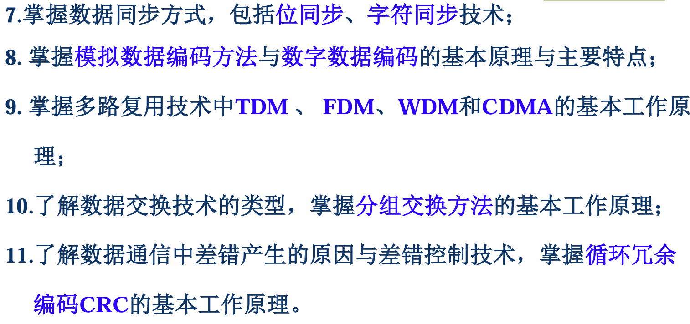
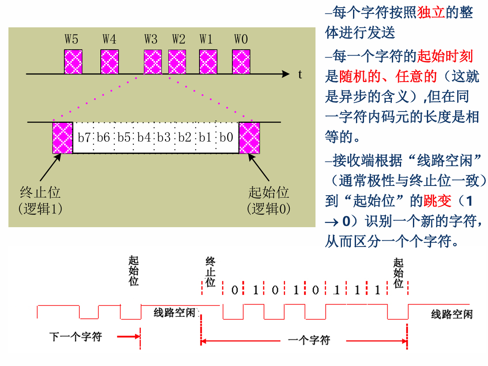
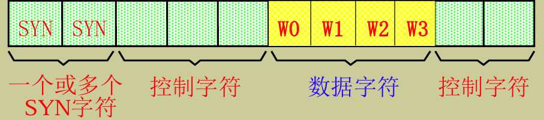
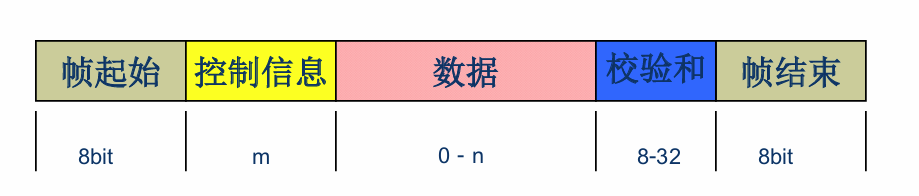

# 第 2 章 数据通信基础

## 2.0 学习要求

## 2.1 数据通信的基本概念

1. 信息：
    - 数字文字语音的**内容或者含义**
2. 数据：
    - 二进制代码表示的数字文本语音等
3. 信号：数据的物理编码（光，电磁波，脉冲）
    - 包含数字信号（脉冲）和模拟信号（电磁波）
1. 信源：
    - 产生和发送信息的一端
2. 信宿：
    - 接收信息端
3. 信道：
    - 信源和信宿之间传送信息的通道
    - 包括数字信道（计算机）和模拟信道（WIFI）
1. 数据通信的基本过程
    - 包含传输数据和通信控制（数据以外的部分）
    - 五个阶段（建立物理连接，建立逻辑连接，数据传送，断开逻辑连接，断开物理连接）

## 2.2 信道及其主要特征

1. 数据通信速率（传输速率）：数据在信道中传输的速度
    - 包括**码元速率（波特率）**和**信息速率（比特率）**
    - log2M × 码元速率 = 信息速率
2. 信道通信方式
    1. 按顺序：串行、并行
    2. 按流向和时间关系：单工、半双工、全双工
3. 数据传输方式
    1. 基带传输：其实就是数字脉冲信号（方波）直接传输，因为方波具有直流分量和低频分量
    2. 频带传输：数字/模拟信号调制到模拟信道上传输
4. 数据同步方式
    1. 位同步
        1. 外同步：发一段时钟信号（01）
        2. 自同步：利用相位编码（曼彻斯特/差分曼彻斯特）
    2. 字符同步
        1. 异步制（字符起止式）：字符有起始位和终止位，不同字符中间可以有线路空闲
       

        2. 同步制（成组的字符）：SYN + 控制字符 + 数据字符 + 控制字符 
           

            + 发送时首先发送同步字符 SYN ，在收到对方的同步应答后， 发送数据及控制字符  
            +  以检测同步字符 SYN 的模式获得时钟信号，达到位同步 
    3. 帧（数据包）同步：靠帧起始和帧结束
   

## 2.3 数据编码技术

## 2.4 多路复用技术

## 2.5 数据交换技术

## 2.6 差错控制及检错

