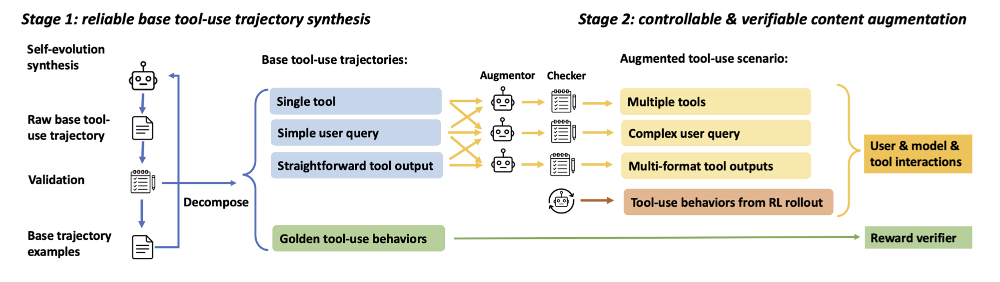
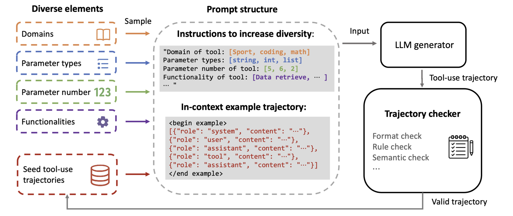
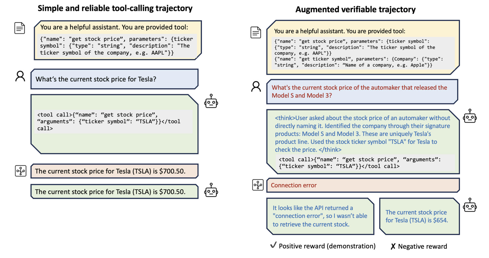

## Agent与后训练合集

### Controllable and Verifiable Tool-Use Data Synthesis for Agentic Reinforcement Learning

一份改进 tool-use agent 的工作，现有的合成的工具使用数据的方法，只适合于 SFT，不适合去做 RL。

**Motion**：

现有能够调用工具大模型，但是在合成环境中强化学习还有 gap，在各种干扰（工具多、问题模糊、返回结果错误）的情况下也可以提升。对 tool-use 的训练使用强化学习应该是一个新的办法，而后者的干扰问题应该是 agent 能力的普遍问题。Oracle-preserving augmentation 应该是指在保证标准答案不变的情况下增加问题的难度，这样既能够方便打分并返回奖励，也能提升 agent 的抗干扰能力。

**Method**：

两个阶段，Stage1：reliable tool-use trajectory generation，Stage2：oracle-preserving augmentation

