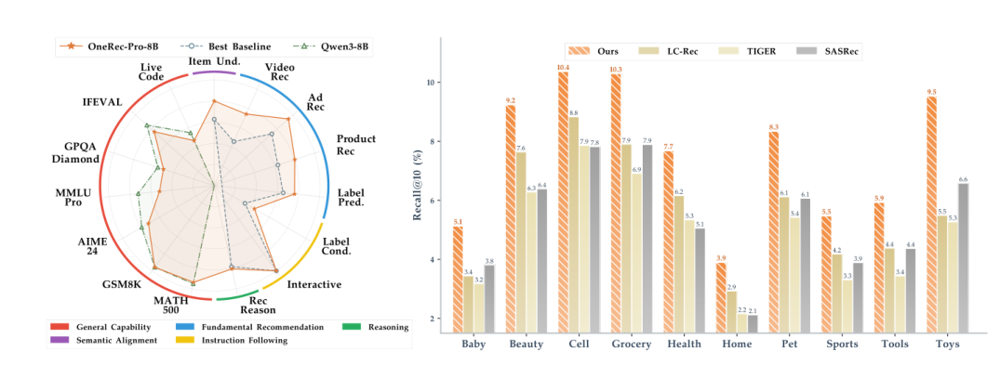
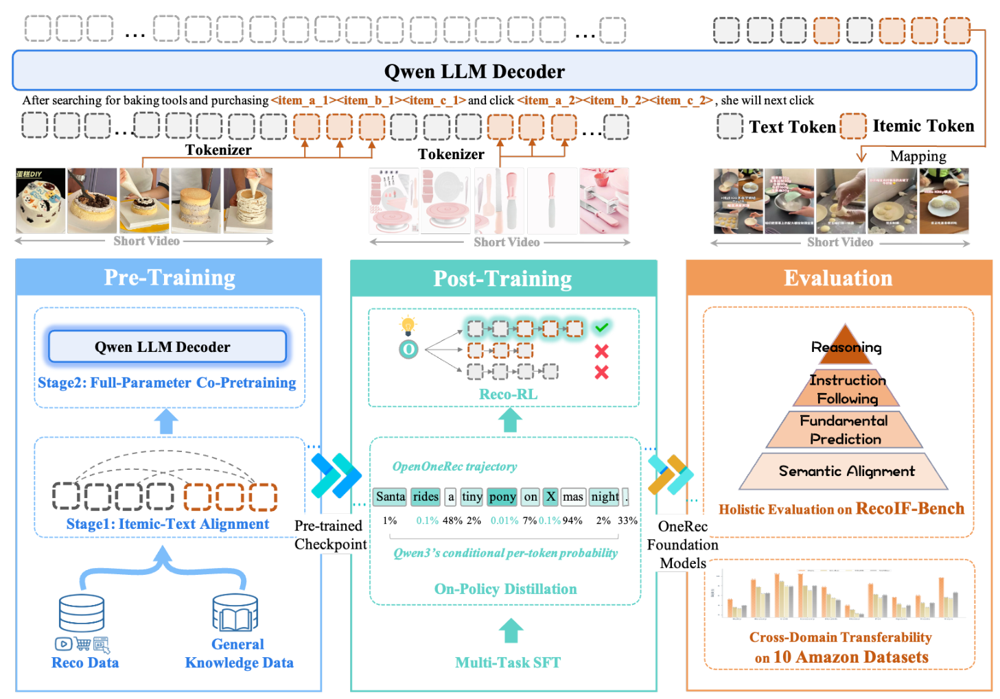
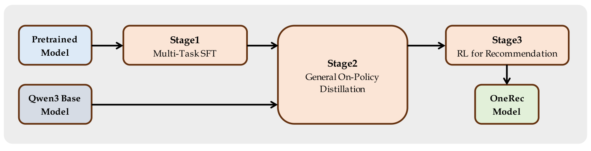
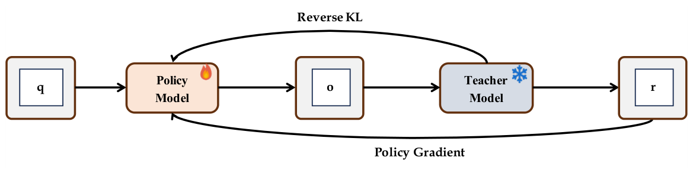
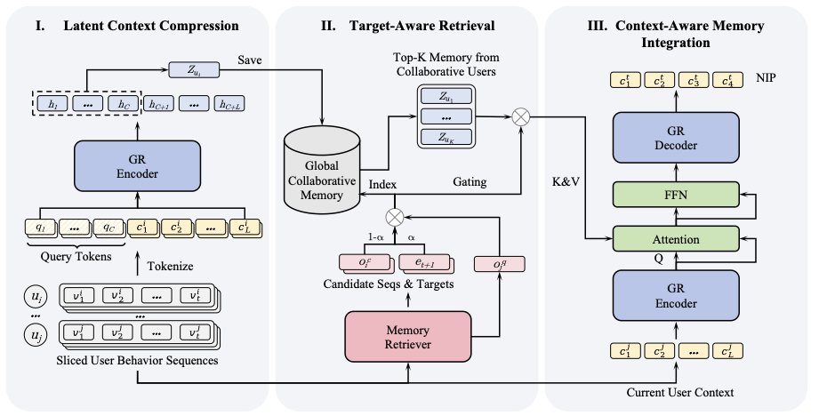

## Generative Recommendation 合辑

### OpenOneRec

https://arxiv.org/pdf/2512.24762

#### Motivation

- OneRec 只吃快手的推荐数据，与 LLM 的预训练数据接不上，享受不到 LLM 的 scaling，同时只能做推荐，听不懂自然语言，也不能解释为什么推荐，也不具备 LLM 通用能力
- 把 SID 对齐进 LLM 的工作（LC-Rec，OneRec-Think），下游任务单一，训完模型通用能力忘的很严重
- 没有能同时考推荐、通用能力和指令的 benchmark

- 做一个推荐的 foundation model，既能做 next-item 推荐，又能听懂自然语言具备通用 LLM能力。能解释为什么推荐，也具备 LLM 原本的数学和代码能力，再做个对应的 benchmark。

#### Method

1. **上方 itemic tokenizer（RQ-Kmeans）**。每个视频用 Qwen3-Embedding-8B 把视频的文本描述编成一个 4096 维向量，逐层做 k-means，每层 8192 个中心，最后变成三个橙色的 itemic token。只需要 3*8192=24576 个 emb。TIGER 用的 RQ-VAE 需要训一个编码器，每层 256 个 code 也少一点，碰撞的时候加第四层去重。k-means 不训练，8192 个 code，碰撞直接不去重，最后选热门的
2. **扩词表**。24576 个 emb 再加 <|sid_begin|> 和 <|sid_end|> 两个 emb，一共新加 24578 个 emb。新的 emb 初始化按旧的 emb 的均值和协方差做多元正态采样，直接 `model.resize_token_embeddings(...)` ，这样不会因为随机初始化跟原来差太多
3. **Qwen3 主干**。从已经做完指令微调和 RL 的 Qwen3 checkpoint 起步。结构完全不动，8B 是 36 层、hidden 4096、GQA（32 个 query 头、8 个 KV 头

#### Training

1. 预训练第一阶段：只训新的 emb，就是 itemic token，NTP 损失
2. 预训练第二阶段：所有参数解冻一起训。数据上，通用 62%，推荐 38%，NTP 损失	
3. 后训练 SFT：推理 65%，推荐 35%
4. 后训练蒸馏：
5. 后训练 RL：

### OMEGA: Collaborative Memory Augmentation for Generative Recommendation

https://arxiv.org/pdf/2608.01315

#### Motivation

- 生成式推荐模型，预测下一个物品时只看当前用户自己的序列，协同信息只靠模型本身记住
- 借鉴 LLM 的 in-context learning，在生成之前，先把兴趣相似的其他用户的行为当作上下文交给模型
- 难点在于检索要能对各种用户都检索得准，把记忆接进现有模型的方式要高效，不能拖慢推理

> 其实感觉生成式的话有的不训大模型，也不微调也直接拿来用，然后加 ICL 或者是直接提示词；有的训模型，包括全参数重训练或者是 PEFT 或者是指令微调。这篇就在后者基础上也上 ICL 吧。

#### Method

1. 潜在上下文压缩（Latent Context Compression，离线）
    - 把所有用户的训练序列切成前缀目标对
    - 每个前缀先转成 SID token 序列，前面拼上 query token，然后过一遍生成式推荐的 encoder
    - 只取 query token 那 C 个位置的输出存进Global Collaborative Memory
    - 训练压缩模型时，decoder 只能看到这 C 个向量，所以它们被迫去概括整个前缀

2. 目标感知检索（Target-Aware Retrieval）
    - 有一个独立的小 HSTU 做检索器
    - 检索打分是 $(1-\alpha)\cos(o^q,o^c)+\alpha\cos(o^q,e_{t+1})$
    - 作用一是作为 “Index” 选出 top-K 条记忆，二是走 “Gating” 那条线，变成系数乘到记忆上

3. 上下文感知融合（Context-Aware Memory Integration，在线）
    - 当前用户的序列照常过 encoder，得到 Q。
    - 然后 Attention，门控后的 K 条记忆作为 K 和 V
    - 输出长度和 Q 一样，所以后面的 decoder 不用改，照常生成 4 个 token 的 SID

### MiniOneRec

https://arxiv.org/pdf/2510.24431

> 照着 OneRec 来的，因为当时还没有 OpenOneRec。个人感觉 OpenOneRec 看起来更优雅一点，毕竟保留了大模型的能力。但是 MiniOneRec 方便复现

#### Motivation

- 解决了一个问题：OneRec 在公开数据集上 scaling 还好不好使？传统推荐参数都在 emb 表里，scale 不起来，但是 sid 了之后进入 transformer 了，就能 scale 了

#### Method
